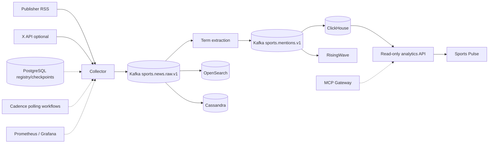

# Sports Pulse — real-time sports conversation analytics

**Status:** initial scaffold and interactive synthetic preview. No live feeds or infrastructure are connected.
Preview: https://ammills01.github.io/netapp-instaclustr/sports/

## Customer story
Collect approved publisher RSS/Atom headlines and optionally official X API posts about American football (NFL/NCAA), worldwide soccer, worldwide cricket, baseball and basketball. Publish normalized items to Kafka, extract terms and aggregate unique-item mentions, then visualize rolling word clouds. Separate social from publisher counts; neither measures audience size. Initial sources are English-language candidates; add regional and multilingual feeds after rights and freshness review.

## Architecture

## MVP milestones
1. Review feed endpoints, attribution, terms, limits and freshness before enabling. Use titles and URLs only where permitted; no full article bodies. Official X search or filtered stream requires approved API access, rate limits, deletion and redisplay compliance. No unofficial X scraping.
2. Poll 2–5 minutes. Normalize stable source/item IDs, sport, timestamp, source type. Deduplicate repeated items with deterministic IDs; distinguish original publication time from observation fallback. Durable PostgreSQL checkpoints and conditional GET are next-stage work.
3. Publish sports.news.raw.v1 and sports.mentions.v1. Use reviewed topic partitions, replication factor and retention (suggest 7 days subject to source rights); sports.news.dlq.v1 is planned. Use Kafka ACLs and verified TLS.
4. English starter tokenizer counts each term once per unique article; ClickHouse query counts distinct event IDs by sport, source and rolling window. Add aliases, multiword entities, language detection, trend acceleration and distinct-publisher measures later.
5. UI filters by sport and 15m/1h/24h. Word size represents mentions, not sentiment or engagement. Preview contains explicitly synthetic illustrative counts. Live read-only analytics API is planned.
6. Extend to RisingWave SQL comparisons, OpenSearch headline search, Cassandra recent items by sport, Cadence polling/retries, Prometheus/Grafana and approved MCP tools. Streambased can demonstrate Iceberg access to Kafka data subject to vendor entitlement and compatibility.

## First pipeline slice
Install requirements in an isolated environment. Create the two Kafka topics and scoped principals. Inject the example settings privately. Run python collector.py --synthetic --once, then python mentions.py in a separate process. To enable approved RSS sources copy feeds.example.json to private/feeds.json, set enabled true only for approved sources, and run python collector.py --rss --feeds private/feeds.json --once. These initial scripts are not tested against your cluster. The collector avoids following redirects; review final feed URLs before enabling. Keep access tokens, credentials and internal addresses outside Git. The static demo has no live API connection.

## Acceptance
One approved source per sport, stable IDs, verified TLS, scoped ACLs, reproducible counts, measured freshness, no secrets or customer data in public artifacts, rights-compliant output. The advanced components are design scaffolds, not live deployments.
